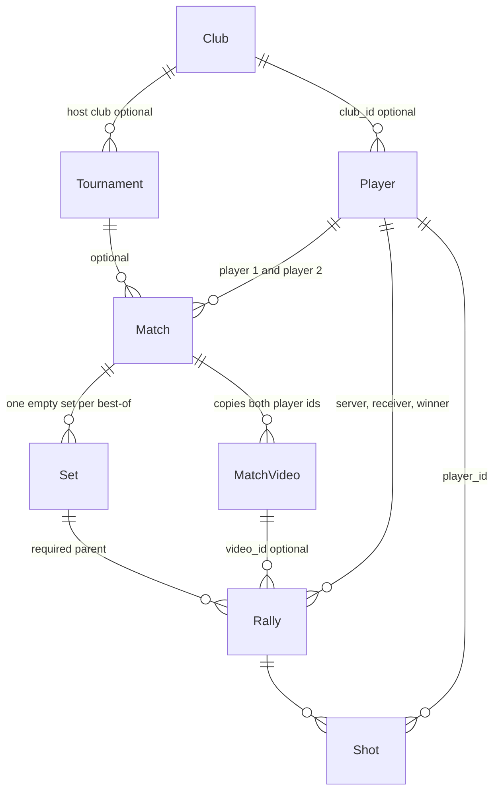
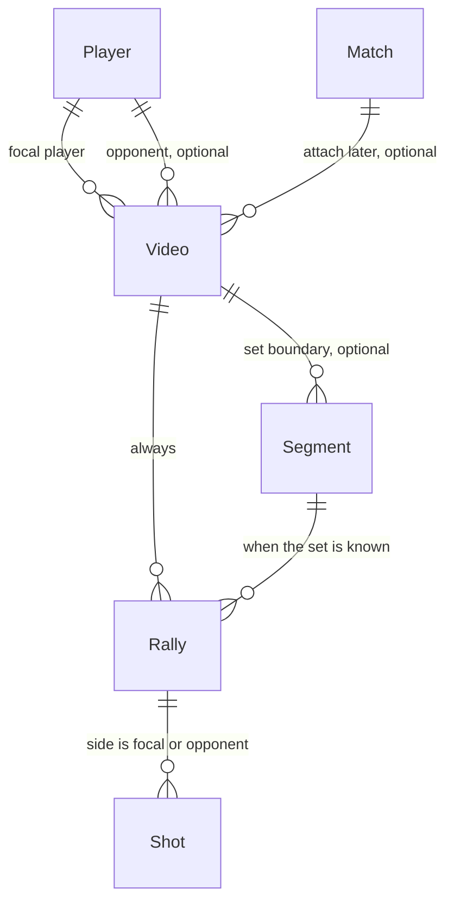

# Table map

Diagrams for how the tables connect. The first is what the app stores today. The second is the looser shape from the 2026-11-11 chat: start from a video, one focal player, opponent and score optional. The second is not built.

Chat notes: [table_links_and_flexible_tagging.md](chat_notes/table_links_and_flexible_tagging.md), [focal_player_and_loose_video.md](chat_notes/focal_player_and_loose_video.md). Plan: [bottom_up_tagging_plan.md](chat_notes/bottom_up_tagging_plan.md).

Field lists: [DataSchema.md](DataSchema.md).

---

## Current

Thin start (v3.32): one focal player opens tagging on a single set at 0–0. Opponent and tournament can wait. The older path still exists for matches that already have two players.

`player_profiles` and `player_skill_metrics` are empty stubs. `shot_inferences` was removed in Dexie v4.

---

## Proposed — video first, one focal player

Not built. A rally stays two-sided so the contact sequence stays true. Analysis is one-sided: full tags on the player you care about, a thin record for the other side.

| Fact | When you have it |
|---|---|
| Focal player | Required before the first rally. The one person these tags are for. |
| Opponent | A player record when you know them. Until then a label, or nothing. |
| Server | A pill. Defaults to the focal player at 0–0. One tap on the other side re-anchors the rotation from that point, including deuce. |
| Score | Counted from the point winners when the clip starts at 0–0. Typed only when the scoreboard disagrees, or when a fragment ends and the score is walked backward. |
| Set | Mark a boundary when you see one. One video can hold several sets, half a set, or no set at all. |
| Match, tournament, best of | After tagging, if the video turns out to be a match. |

There is no login in the app. The focal player is a field on the video, not an account.
