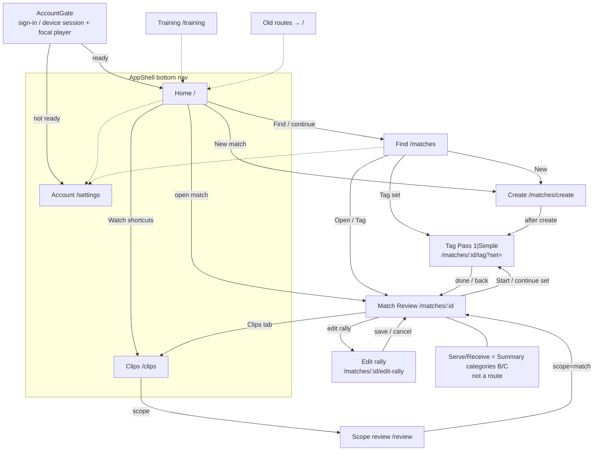
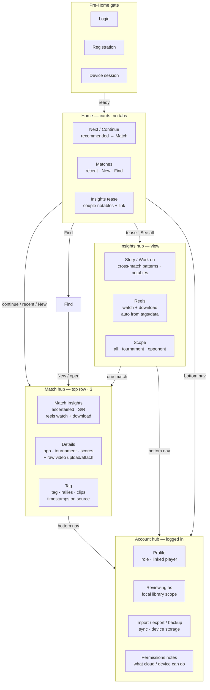

# Current pages map (live app)

Source: tip of `main` at checkout (`app/src/App.tsx` + page composers). Not the ideal docs.

## Current — flowchart

**Data conditionals (edges still exist; UI swaps):**
- **No matches** → Home / Find empty states (create / import).
- **Match, nothing tagged** → Review Summary/Work on/Clips show “Nothing tagged yet”; Details + Rallies still usable.
- **No clip presets** → Clips empty (“star / flag in Pass 1”).
- **Wrong focal / not signed in** → AccountGate blocks shell + tag/edit (Settings stays open).

## Current — page table

| Page | Route | What’s on it | Shows when / hides when |
|------|-------|--------------|-------------------------|
| **Home** | `/` | Outstanding tagging, optional context polish, recent matches, clip shortcuts; New match | Empty dashed CTA if 0 matches; “What’s left” / Watch only when those lists have items |
| **Find** | `/matches` | Filters + match cards → Open / Tag / Details / results | Empty: no matches or filter miss; scoped to focal player |
| **Create** | `/matches/create` | Thin form (you + optional opp/tournament) → creates set 1, opens tag | Needs focal player; dupe soft-warn |
| **Match Review** | `/matches/:id` | Tabs: Summary · Details · Work on · Clips · Rallies; set video / storage on Details | Not found → Home; no point data → empty card on Summary/Work on/Clips; `?tab=` + `?cat=` / `?clip=` |
| **Tag Pass 1** | `/matches/:id/tag?set=&mode=` | Full-screen tagging (`pass1focus` default, or `simple`) | Needs match + `set`; exits to Review |
| **Edit rally** | `/matches/:id/edit-rally?set=&rally=` | Full-screen one-rally fix | Needs set+rally; back to Review |
| **Clips** | `/clips` | Cross-match playlists, stage, reels; `?clip=` / `?scope=` | Empty until tagged/highlighted; also embedded as Review Clips tab |
| **Serve / Receive** | *(no route)* | Summary categories **B Serve Data** / **C Receive Data** (`?cat=B\|C`) | Only after point data; inside Review Summary |
| **Scope review** | `/review` | Cross-match Clips (+ matches tab); scope control | `scope=match` redirects to that match Review |
| **Training** | `/training` | Practice posts (shot-type / combo clips), compare months | Needs focal; empty lists until posts saved; **not** in bottom nav |
| **Account / Settings** | `/settings` | Sign-in / device session, reviewing-as, import, sync, clear/dummy data | Always reachable; **no** AccountGate wrapper |
| **Redirects** | `/clubs` `/tournaments` `/players` `/analytics` `/data-viewer` `/data-viewer/audit` | — | All `Navigate` → `/` |

**Shell:** bottom nav = Home · Clips · Account. Find / Create / Training / Review are in-app links, not primary tabs. Tag + Edit rally are full-screen (no shell).

---

## Proposed — hubs

Living. Full MVP surface: **Gate** → **Home** → hubs (**Match** do · **Insights** see · **Account** identity/data).

**Clip vs Reel (locked)**
- **Clip** = timestamps on source video → review / nudge under **Tag** (not a top hub / destination).
- **Reel** = auto outcome of tags/data → watch + download under **Match Insights** / **Insights hub**.

**Bottom nav (proposed):** Home · **Insights** · **Account** — Clips destination **CUT** (or map today’s Clips tab → Insights).

**Deltas vs current**
- Explicit **Gate** before Home (login / register / device session).
- **Account** = real hub (not just settings dump); same IA depth as Match.
- **Match Review → Match**; top row **Match Insights · Details · Tag**.
- **Clip** → Tag; **Reel** → Match Insights / Insights hub.
- **Create** / **Clips** page / bottom-nav Clips → **CUT** or fold into Insights.

---

## Gate IA (working)

Pre-Home — unlock a session, then land on **Home**. Not a logged-in hub.

**What makes up the gate**
- Cloud **login** / **registration**
- **Continue on this device** (local session)
- Ready when session + reviewing-as / focal can be resolved (focal may finish in Account)

**Top structure** — single screen / steps (no app tabs)

| Area | Contents | Call |
|------|----------|------|
| **Login** | Sign in to cloud account | **KEEP** |
| **Registration** | Create account | **KEEP** |
| **Device session** | Continue on this device without cloud | **KEEP** |
| App chrome / Home cards / Match | — | **CUT** until ready |

**Move out / cut**
- Profile / reviewing-as depth → **Account** (after ready)
- Import / clear-data / dummy → **Account**

---

## Match hub IA (working)

One match — do + see *this* match. Same three tabs as Proposed Mermaid.

**What makes up a match**
- Identity / result / raw video → Details
- Tags, rallies, **clips** (timestamps) → Tag
- Ascertained story + **reels** (watch/download) → **Match Insights**

**Top row (3)** — Match Insights · Details · Tag

| Tab | Contents | Call |
|-----|----------|------|
| **Match Insights** | Ascertained for *this* match; **reels** watch + download | **KEEP** |
| **Details** | Opp, tournament, scores, date + **raw upload/attach** | **KEEP** |
| **Tag** | Tag with set videos; rallies; **clip** timestamps / nudge | **KEEP** |
| **Clips** top tab | — | **CUT** |

**Move out / cut**
- Match **Clips** top tab / Clips-as-destination → **CUT** (reels → Match Insights; clips → Tag)
- Cross-match Work on → **Insights hub**
- **Create** page · **Rallies** top tab · **Videos** top tab → **CUT**

---

## Insights hub IA (working)

Cross-match **viewing** hub — like Match, but see (data + **reels**), not do (no Tag chrome). Same structure depth as Match.

**What makes up Insights**
- Cross-match patterns / Work on / notables → **Story / Work on**
- Auto **reels** from tags/data (watch + download) → **Reels**
- Who/what you’re viewing across → **Scope** (all · tournament · opponent)
- Drill to one match → **Match** / Match Insights (exit, not a tab)

**Top structure (3)** — Story / Work on · Reels · Scope  
*(working labels — knock around; not Match-style “do” tabs)*

| Area | Contents | Call |
|------|----------|------|
| **Story / Work on** | Cross-match patterns, notables, coaching cues | **KEEP** |
| **Reels** | Watch + download reels (auto from tags/data) | **KEEP** |
| **Scope** | All / tournament / opponent (filters the above) | **KEEP** |
| Clip browser / timestamp nudge | — | **CUT** → Tag on Match |
| Per-match Details / raw upload | — | **CUT** → Match Details |
| Clips as own hub / bottom-nav Clips | — | **CUT** → this hub |

**Move out / cut**
- **Clip** editing → Match **Tag**
- Full Insights UI on Home → **CUT** (Home teases only)
- Old `/clips` destination → fold here or **CUT**

---

## Home IA (working)

Cross-match **dashboard** after **Gate** — teases hubs; no top-tab row. Same depth as Match IA.

**What makes up Home**
- Recommended next action → **Next / Continue** → Match
- Library surface → **Matches** (recent → Match; New → empty Match; Find)
- Peek at global coaching → **Insights tease** → Insights hub
- Not: Tag chrome, Match Insights panels, Account deep UI, Training, Clip/Reel players, Gate forms

**Top structure** — **cards only** (no tab row)

| Card | Contents | Call |
|------|----------|------|
| **Next / Continue** | Outstanding / recommended → opens **Match** | **KEEP** |
| **Matches** | Recent → Match; **New** → empty Match; **Find** | **KEEP** |
| **Insights tease** | Couple notables + **See all → Insights hub** | **KEEP** (light) |
| Home top tabs | — | **CUT** |
| Clips chip / Clips destination | — | **CUT** → Insights |
| Full Insights / Work on on Home | — | **CUT** → Insights hub |
| Account deep UI · Training · Match chrome · Gate | — | **CUT** |

**Move out / cut**
- Depth lives in **Match** / **Insights** / **Account** — Home only routes
- Bottom-nav reaches Account; don’t embed it on Home

---

## Account hub IA (working)

Logged-in **identity + library data** hub — same depth as Match. Not Match tagging; not Insights story.

**What makes up Account**
- Who you are → **Profile** (role, linked player)
- Whose library you’re in → **Reviewing as** (focal scope)
- Moving data on/off device → **Import / export / backup** (+ sync / storage)
- What cloud vs device may do → **Permissions notes**

**Top structure (4)** — Profile · Reviewing as · Import / export / backup · Permissions notes

| Area | Contents | Call |
|------|----------|------|
| **Profile** | Role, linked player, sign out / switch session | **KEEP** |
| **Reviewing as** | Focal player / library scope | **KEEP** |
| **Import / export / backup** | Bundle import/export, cloud sync, device storage | **KEEP** |
| **Permissions notes** | Short plain notes: cloud, device, what needs sign-in | **KEEP** |
| Login / register / device-session forms | — | **CUT** → Gate (pre-Home) |
| Match Tag / Insights / Home cards | — | **CUT** |
| Clear-all / dummy-data (dev) | optional under backup | **KEEP** light or hide in MVP |

**Move out / cut**
- Gate auth flows stay **pre-Home**
- Per-match raw video upload stays **Match Details**
- Reels watch/download stay **Insights** / Match Insights
