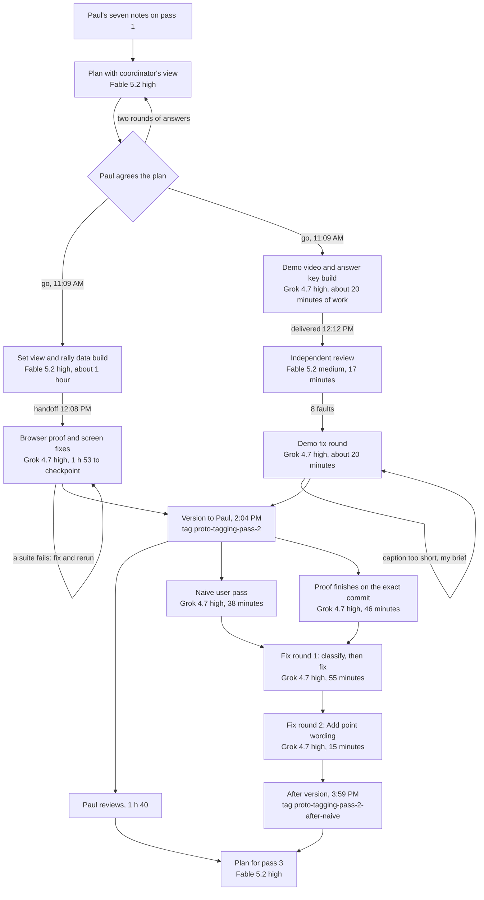

# Second tagging pass: how it ran, what it cost in time, and what to change

15 Nov 2026. All times UK time. Written by the coordinator for Paul, who asked for it because the pass took too long for its scope and he is available to review during the day.

Related: [model log](model-choices.md), [the plan that was built](proto-tagging-pass-2-plan.md), [the saved process](../workflows/coordinated-build-review-loop.md).

## The short version

- From "go" to a version Paul could try: about 2 hours 55 minutes (11:09 AM to 2:04 PM). To the end of the naive user pass fixes: about 4 hours 50 minutes (3:59 PM).
- Both builds were finished by 12:12 PM. The version sat for 1 hour 52 minutes behind a scripted browser proof before Paul saw it.
- That proof found two screen faults and no rule faults. Paul's own hour with the version produced about 20 notes on layout and flow, none of which any script or reviewer raised.
- So the biggest saving is simple: Paul gets the version when the builds finish, and the checks run while he reviews.

## Flow as it ran

Loops in it:

1. **Plan loop** (Paul and coordinator): two rounds before "go". Worth it. The first Add rally design was wrong and one item was thrown out here, before any build.
2. **Proof loop** (inside one worker): run a suite, fix a screen fault, rerun. This is where the time went. The suites drive the demo video in real time, so one whole match run at one screen size takes many minutes, and it was rerun after each change.
3. **Review and fix loop, demo video**: one review, one fix round, one follow up caused by a mistake in my brief.
4. **Naive user pass loop**: one pass, two fix rounds (the second was 15 minutes).

## Who did what, what they found, and the time

| Stage | Agent and model | Time | Ran alongside | Significant findings |
|---|---|---|---|---|
| Plan and review of Paul's notes | Coordinator and a planning worker, Fable 5.2 high | Morning, not timed | Nothing | Dropped lets, 2 seconds before the serve, item 11 out. First Add rally design replaced with "each rally keeps what it was tagged with" plus continuity marks. |
| Set view and rally data build | Tagging set view and rally data, Fable 5.2 high | About 1 hour (11:09 AM to 12:08 PM), with a stall on a usage limit | Demo build | Rules and screens built. 79 of 79 fast script checks on the rules. Stopped before long browser work, as agreed. |
| Demo video and answer key build | Demo video and answer key, Grok 4.7 high | About 20 minutes of work, delivered 12:12 PM. About 40 minutes lost before that to the usage limit and two model changes. | Set view build | Built to the brief. Its own 19 of 19 checks passed. |
| Demo review | Demo video and answer key review, Fable 5.2 medium | 17 minutes | Browser proof | 8 faults the builder's checks missed: stroke not readable from the picture, a late tap hidden by an average, the key pushing the list down, touch targets, wording. |
| Demo fix round | Demo video and answer key, Grok 4.7 high | About 20 minutes, plus a short follow up | Browser proof | All 8 fixed. Followed a mistake in my brief (a 0.2 second caption) without questioning it. |
| Browser proof and screen fixes | Set view browser proof, Grok 4.7 high | 1 h 53 to the checkpoint (12:09 PM to 2:02 PM), 2 h 39 to every suite passing on the exact commit (2:48 PM). Overran its deadline by 17 minutes. | Demo review and fixes | No rule faults. Two real screen faults: phone touch targets, and a Let message covering the top row of result buttons. More than 600 checks passed. |
| Paul's review | Paul | 1 h 40 (2:04 PM to 3:44 PM) | Naive user pass, fix round 1 | About 20 notes on layout, flow and wording, plus the simulator idea. None of them was raised by a script or a reviewer. |
| Naive user pass | Tagging naive user pass, Grok 4.7 high | 38 minutes | Paul's review, proof reruns | 13 findings. On a second look: 5 real and small, 4 did not reproduce, the rest were behaviour Paul chose or that pass 1 already had. One real catch: Add point landing before the rally. |
| Fix round 1 | Set view browser proof, Grok 4.7 high | 55 minutes against a 45 minute bound, most of it suite reruns | Paul's review | Classified every finding as reproduced or not, and as pass 1 or pass 2. Fixed the phone Edit size, controls sitting on shot chips, the Captions label, the cleared message. |
| Fix round 2 | Set view browser proof, Grok 4.7 high | 15 minutes | Pass 3 planning | Add point cards now say where the point lands. Found that a tap in the first second after the questions open still counts as a contact (the late tap rule). |
| Surface pulls | Proto hub wireframes, Composer 2.5 fast | About a minute each, three times | Everything | None. Did exactly what was asked. |
| Coordination | Coordinator, Fable 5.2 high | Throughout | Everything | Two mistakes of mine: the caption brief, and passing four naive pass findings to Paul before they were confirmed. They did not reproduce. |

## Where the time went

| Part | Time | Share of the 4 h 50 |
|---|---|---|
| Builds (both, side by side) | About 1 hour | 21% |
| Browser proof before Paul saw anything | 1 h 53 | 39% |
| Naive user pass and its two fix rounds, with proof reruns | 1 h 55 | 40% |

Lost inside those: about 40 minutes to the usage limit and model changes at the start, and well over an hour to rerunning real time suites after each small change.

## What I would change

**1. Paul sees it first.** When the builds pass their fast rule checks and a ten minute smoke run at phone and desktop, the version goes to Paul. On this pass that was about 12:30 PM, not 2:04 PM. Scripted proof, cross family review and the naive user pass all start at that same moment and run while he reviews. This is the change you already asked for part way through, taken one step further.

**2. One fix round, not three.** Paul's notes, the review, the naive pass and any proof faults are gathered into one list, I sort it once, and it becomes one fix round or the next plan. On this pass the fixes from the naive pass tidied two controls that Paul's notes then removed.

**3. Make the proof cheap.** Three things:
- A test only speed switch so suites play the demo video at 4x or more. The rules do not depend on playback speed; the suites only need the video clock.
- After a change, rerun only the suite that covers what changed. The whole match run happens once, on the final commit.
- A hard checkpoint every 45 minutes: push what is verified and report, then carry on.

I expect these to bring the proof from 2 h 39 to about 40 minutes.

**4. Naive findings are confirmed before they reach Paul.** The pass itself stays blind (it must not be told what was chosen, or it stops being naive). But a 15 minute "does it reproduce, and was pass 1 already like this" check comes before I report anything. I skipped that today and warned Paul about four things that were not there.

**5. Smaller slices.** Pass 2 was 15 items in one build. Split by independence so that screen only items (labels, row layout, a status line) reach Paul within the hour while the one hard logic item is still being built.

**6. Agents.**
- Fable 5.2 high: plan and rules only. That was about an hour of worker time today and it is where it earns its place.
- Grok 4.7 high: build, proof, naive pass and fixes all held up. Keep it for all four. Its weakness is that it follows a brief to the letter, so briefs must be right.
- Fable 5.2 medium reviewing a Grok build: 17 minutes for 8 real faults. The best value of the day. Use it on every Grok build.
- Composer 2.5 fast for pulls and other mechanical jobs: keep.
- Trial for pass 3: Grok 4.7 xhigh on the hard logic item (the serve review), with Fable 5.2 medium reviewing the rule. If it holds, Fable is only needed for planning.
- Always name the model. The stall at the start came from workers silently inheriting Fable.

## The daytime loop I propose for pass 3

1. Plan with my view on each note, bounded to 35 minutes. Paul agrees it.
2. Build in independent slices side by side, each bounded to 45 minutes, each proven by fast checks named in the plan.
3. Version to Paul as each slice lands, with a tag.
4. While Paul reviews: cross family review (20 minutes), naive user pass (30 minutes) and targeted proof, all at once.
5. One sorted list, one fix round of at most 30 minutes, whole match run once, tag.

Target: plan agreed to first version in about 1 hour 15 minutes, and the whole loop in about 2 hours, against 2 hours 55 and 4 hours 50 today.

## What I am not sure of

- The morning planning time was not recorded, so it is missing from the totals.
- The 4x speed switch is an estimate. If some suite depends on real time behaviour (the 2 second idle close does), that suite stays at normal speed.
- One day of evidence. The model log needs more passes before the picks are settled.
