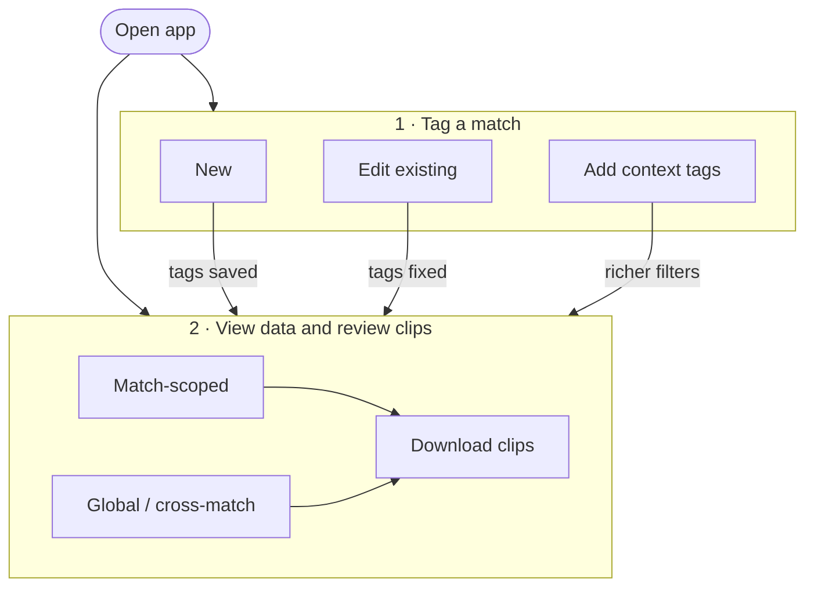
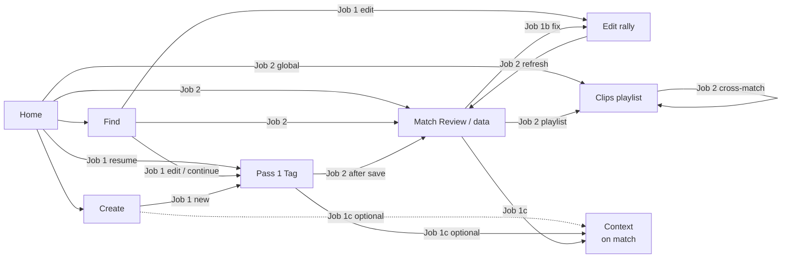
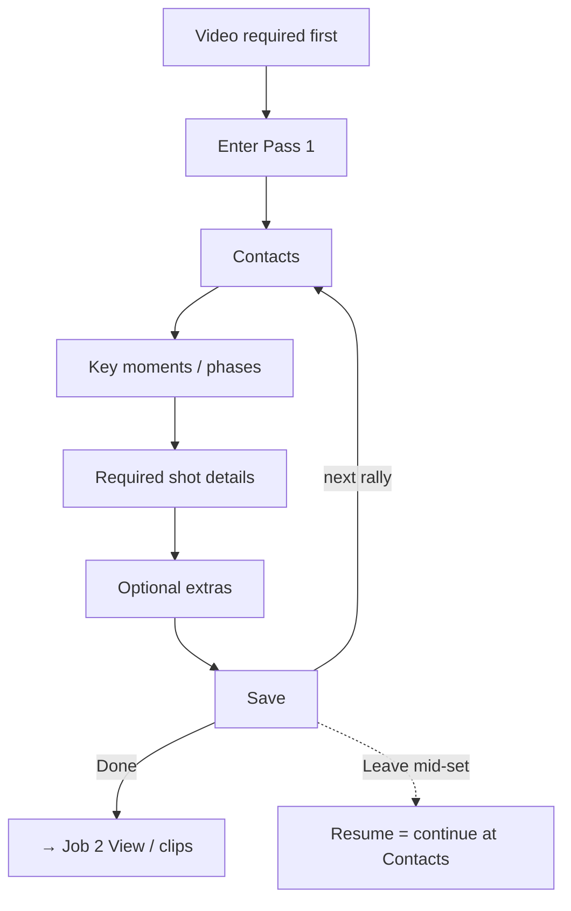
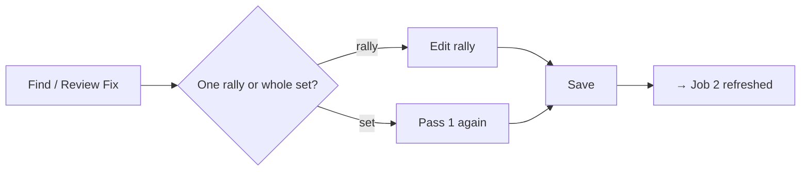
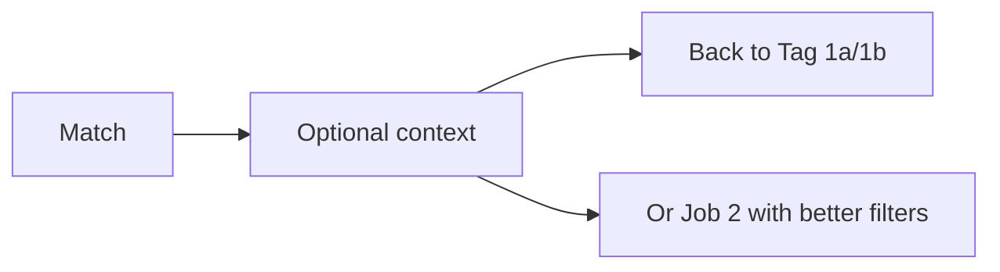
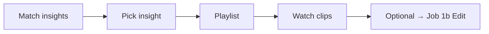
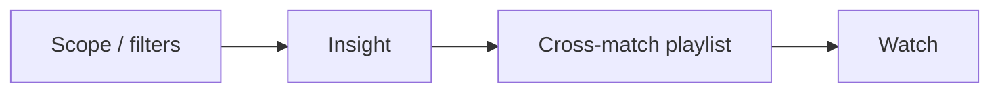
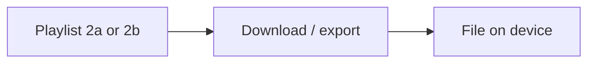
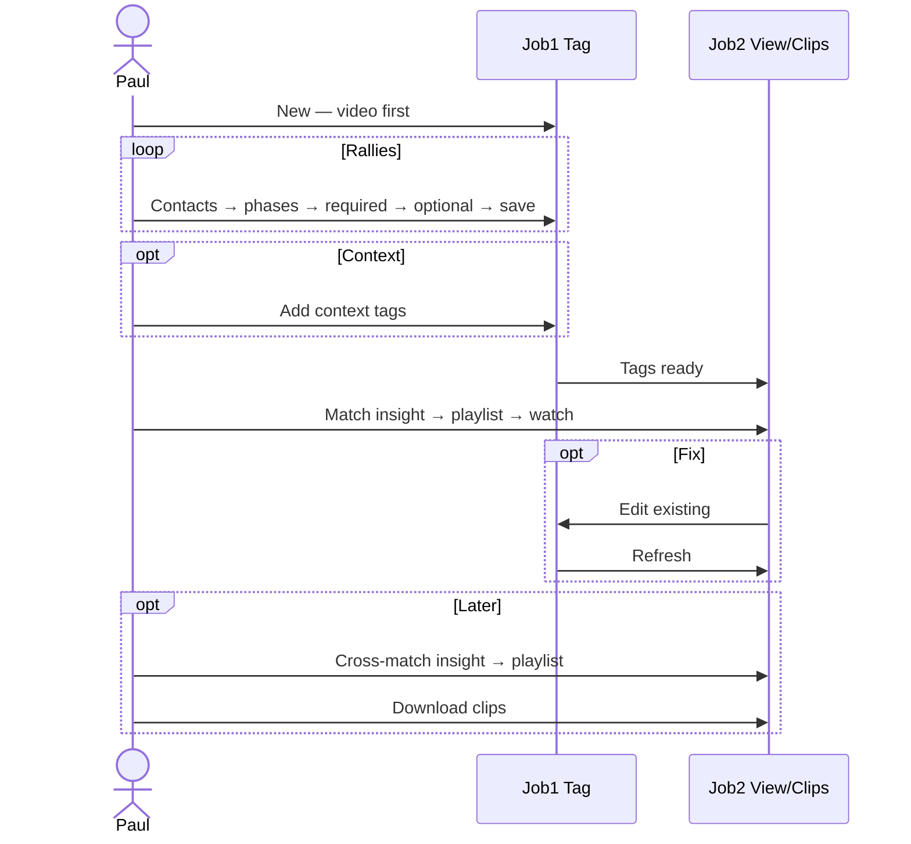

# User flows — Match Analyser

**Audience:** Paul  
**Updated:** 2026-11-14  
**Parent:** [route-planning.md](./route-planning.md) · [ideal-functionality.md](./ideal-functionality.md)

Two top-level jobs only. Pass 1 primary · insights → playlists · phone-first.

Paul: ☐ Sign (Gate 2)

**Out of scope for flows:** Account / settings · video trim/archive (Later) · Simple as primary.

---

## The two jobs

| # | Job | Branches |
|---|-----|----------|
| **1** | **Tag a match** | New · Edit existing · Add context tags |
| **2** | **View data & review clips** from those tags | Match-scoped · Global / cross-match · Download clips |

Find, create, and resume are **entry steps** under Tag (New / Edit) — not separate top-level flows.

---

## Screens — what lives where

Less-is-more. Prefer folding Find/Create into Home if proto proves one entry screen is enough.

### Screen map (nav + jobs on edges)

### Per screen

| Screen | Purpose | Primary actions | Job(s) | NOT on this screen |
|--------|---------|-----------------|--------|---------------------|
| **Home** | Land · see outstanding · pick a job | Continue tagging · open recent match to view · (optional) Find / Create | Entry to **1** & **2** | Full stats · playlists · Pass 1 chrome · settings deep-dive |
| **Find** | Locate a match (may fold into Home) | Filter · open → Tag or Review | Entry to **1** / **2** | Tagging UI · clip player · long insight pages |
| **Create** | Start a match shell (may fold into Home) | Attach **video first** · light fields · go Tag | **1 New** | Pass 1 controls · Review/clips · forced full metadata |
| **Pass 1 Tag** | Tag one set | Contacts → phases → required → optional → save → next · Leave/Resume | **1 New** (+ resume) | Insights · playlists · download · browsing other matches |
| **Edit rally** | Fix one rally’s tags | Same Pass 1-order fields for that rally · Save · back | **1 Edit** | Whole-set tagging by default · Work-on cards · global scope |
| **Context** | Optional match metadata | Edit opponent / tournament / date / … · save | **1c** (from Create, Review, or Tag side panel) | Never a blocking gate · not its own top-level nav item |
| **Match Review / data** | Match-scoped insights that open evidence | Pick insight · open playlist · jump Fix / Tag set · edit context | **2 Match** (+ door to **1**) | Live contact tapping · global multi-match lists (use Clips/scope) · dead-end number grids |
| **Clips playlist** | Watch / export tagged evidence | Play shot or rally · switch playlist · **Download** · cross-match scope | **2** (match + global + download) | Changing FA/contacts · creating matches · settings |

**Placement rules**

1. Tagging chrome lives only on **Pass 1** / **Edit rally**.  
2. Numbers live on **Review** only if they open **Clips**.  
3. **Download** lives on **Clips**, not buried in settings.  
4. **Context** is a panel/section on the match — not a separate app area.  
5. If Find + Create stay thin, proto may merge them into **Home** (still Job 1 entry).

---

## Job 1 — Tag a match

### 1a · New

**Entry:** Create (or Find → nothing yet) · video required first.  
**Exit:** Rallies saved · ready for Job 2.  
**Resume:** Home Continue lands mid-set here — same loop.

| Step | Do | Before next |
|------|-----|-------------|
| 1 | Attach / confirm **video** | Video ready (or honest missing — cannot tag) |
| 2 | Optional light create fields if needed | Match shell exists |
| 3 | Pass 1: mark **contacts** through the point | Contacts exist |
| 4 | Mark **key moments / phases** (end · FA or No Attack · phase groups) | End + FA/No Attack decided |
| 5 | Enter **required shot details** (compulsory gates) | Basic saveable |
| 6 | Optional **extras** (phase L/R, Review flag, ★ on rail) | Skippable |
| 7 | **Save** rally (or Let / Discard) | Stored or discarded |
| 8 | Next rally → repeat 3–7 · or Done | Set left cleanly |

### 1b · Edit existing

**Entry:** From Job 2 (mistake spotted) or Find → match → edit / continue tag.  
**Exit:** Tags fixed · Job 2 refresh.

| Step | Do | Before next |
|------|-----|-------------|
| 1 | Open match that already has tags | Match found |
| 2 | Edit one rally **or** re-enter Pass 1 for a set | Target clear |
| 3 | Same Pass 1 order as 1a for changed shots | Required details valid |
| 4 | Save → return to view/clips | Evidence honest again |

### 1c · Add context tags

**Entry:** Anytime on a match — never blocks tagging.  
**Exit:** Opponent / tournament / date / etc. stored · improves Find & Job 2 filters.

| Step | Do | Before next |
|------|-----|-------------|
| 1 | Open match context | Match exists |
| 2 | Add or edit optional fields | — |
| 3 | Save · keep tagging or viewing | Context not required to tag |

---

## Job 2 — View data and review clips

Depends on Job 1 tags. Every insight must open a **playlist** (no dead-end numbers).

### 2a · Match-scoped

**Entry:** After tagging · or Find → open match.  
**Exit:** Watching a playlist for this match.

| Step | Do | Before next |
|------|-----|-------------|
| 1 | Open match review / insights | Tagged rallies exist |
| 2 | Pick insight (Summary / Work on / Highlights / …) | Insight selected |
| 3 | Open **playlist** of evidence | Playlist built |
| 4 | Watch shot or whole rally | — |
| 5 | Optional → Edit (Job 1b) | — |

### 2b · Global / cross-match

**Entry:** Scope (all / opponent / tournament / date) after several matches tagged.  
**Exit:** Cross-match playlist watch.

| Step | Do | Before next |
|------|-----|-------------|
| 1 | Set scope | ≥1 other tagged match useful |
| 2 | Pick insight / pattern | Insight selected |
| 3 | Open cross-match playlist | Playlist built |
| 4 | Watch | — |

### 2c · Download clips

**Entry:** From any playlist (2a or 2b).  
**Exit:** Local export / reel for coach or self.

| Step | Do | Before next |
|------|-----|-------------|
| 1 | From playlist choose download / export | Playlist non-empty |
| 2 | Get file on device | — |

---

## Happy-path day (both jobs)

---

## Folded (not top-level)

| Old separate flow | Where it lives now |
|-------------------|--------------------|
| Find / Create | Entry to Job 1 New or Edit |
| Resume | Job 1 New loop · Continue mid-set |
| Review + Work-on | Job 2a |
| Cross-match insights | Job 2b |
| Edit tags | Job 1b |
| Download | Job 2c |
| Video lifecycle | **Deferred** |
| Account / settings | **Out of scope** for this workshop |
